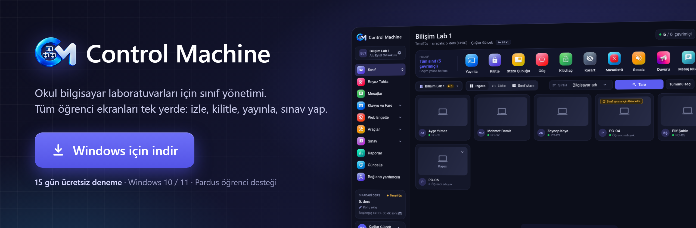

<p align="center">
  <a href="https://github.com/caglargulcek/ControlMachine/releases/download/v0.1.50/ControlMachine-Kurulum-0.1.50.exe"></a>
</p>

<p align="center">
  <a href="../../releases/latest"></a>
</p>

<p align="center">
  <a href="https://github.com/caglargulcek/ControlMachine/releases/download/v0.1.50/ControlMachine-Kurulum-0.1.50.exe"><b>⬇️ ControlMachine-Kurulum-0.1.50.exe indir</b></a><br>
  <a href="https://github.com/caglargulcek/ControlMachine/releases/download/v0.1.50/ControlMachine-Telefon-1.3.5.apk">📱 Öğretmen telefon uygulaması</a> · <a href="https://github.com/caglargulcek/ControlMachine/releases/download/v0.1.50/ControlMachine-Ogrenci-Android-0.1.6.apk">📲 Android öğrenci (tablet) uygulaması (beta)</a> · <a href="../../releases/latest">Sürüm notları</a>
</p>

---

## Videolar

<table>
  <tr>
    <td align="center" width="50%">
      <a href="https://www.youtube.com/watch?v=G7eo515SNTE"></a><br>
      <b>▶️ <a href="https://www.youtube.com/watch?v=G7eo515SNTE">Tanıtım videosu</a></b>
    </td>
    <td align="center" width="50%">
      <a href="https://www.youtube.com/watch?v=TfmHmHJCdUk"></a><br>
      <b>▶️ <a href="https://www.youtube.com/watch?v=TfmHmHJCdUk">Kurulum videosu</a></b>
    </td>
  </tr>
</table>

## Neler yapabilirsiniz?

- **Canlı izleme** — Öğrenci ekranlarını ızgara, liste ya da sınıf planı düzeninde anlık görün.
- **Tek tıkla komut** — Kilitleyin, karartın, sessize alın, duyuru gönderin; tüm sınıfa ya da seçtiğiniz öğrencilere.
- **Ekran yayını ve uzaktan yardım** — Kendi ekranınızı yansıtın, bir öğrencinin ekranını büyütüp fare ve klavyeyle yardım edin.
- **Dosya gönder, ödev topla** — Dosya ya da klasör gönderin, ödevleri tek tıkla geri toplayın.
- **Site ve program aç** — Sık kullandığınız siteleri ve programları kaydedin; derste listeden seçip tek tıkla tüm sınıfta açın.
- **Sınav** — Soru havuzundan sınav hazırlayın; sonuçlar PDF olarak ve e-Okul için hazır tablo olarak kaydedilir.
- **Birden çok laboratuvar** — Aynı ağdaki laboratuvarları ayrı sınıflar olarak yönetin; her sınıf yalnız kendi bilgisayarlarını görür.
- **Zeka Testi** — BİLSEM tarzı, soru başına süreli, geri dönüşsüz test; öğrenci sonunda hatalarını soru soru ve skor tablosunu görür.
- **Yarışmalar ve ünite testleri** — Bilgi, zekâ, klavye ve fare yarışmaları; 5. ve 6. sınıflar için hazır, görselli ünite testleri; canlı skor tablosu.
- **Güvenli internet** — İstenmeyen siteleri ve programları engelleyin, uygunsuz kelimelerden haberdar olun.
- **Ders programı ve zil** — Teneffüste ekranlar kendiliğinden kilitlenir, gün sonunda bilgisayarlar kapanır.
- **Telefondan yönetim** — Karekodu okutun, sınıfı cebinizden yönetin.
- **Windows, Pardus ve Android** — Windows öğrenci bilgisayarları, Pardus akıllı tahtalar ve Android tabletler desteklenir.

## Sistem gereksinimleri

| | |
|---|---|
| **Öğretmen bilgisayarı** | Windows 10 / 11, 64 bit |
| **Öğrenci bilgisayarları** | Windows 10 / 11, Pardus ya da Android 7 ve üstü tablet |
| **Ağ** | Öğretmen ve öğrenci bilgisayarları aynı okul ağında |
| **İnternet** | Yalnızca ilk etkinleştirme için |

## Kurulum

> Adım adım anlatım için: **[Kurulum videosu](https://www.youtube.com/watch?v=TfmHmHJCdUk)**

### 1. Öğretmen bilgisayarı
1. [Son sürüm](../../releases/latest) sayfasından **ControlMachine-Kurulum-x.y.z.exe** dosyasını indirin.
2. Dosyaya çift tıklayın, lisans sözleşmesini kabul edip kurulumu tamamlayın.
3. İlk açılışta e-posta adresinizi girip **Etkinleştir** deyin.

> Kurulum dosyası henüz kod imzası taşımadığı için Windows **"Bilinmeyen yayıncı"** uyarısı gösterebilir:
> **Ek bilgi › Yine de çalıştır** ile devam edin.

### 2. Öğrenci bilgisayarları
1. Öğretmen konsolunda **Güncelle › Kurulum paketi hazırla**'yı seçin (Windows ya da Pardus).
2. Oluşan **tek kurulum dosyasını** USB bellekle ya da ağ üzerinden öğrenci bilgisayarına taşıyın.
3. Öğrenci bilgisayarında çalıştırın ve yönetici iznini onaylayın. Bilgisayar birkaç saniye içinde öğretmen ekranında belirir.

### 3. Android tabletler
1. [Son sürüm](../../releases/latest) sayfasından **ControlMachine-Ogrenci-Android-x.y.z.apk** dosyasını tablete indirip kurun (Android 7 ve üstü).
2. Uygulamayı açıp istenen izinleri verin; tablet aynı ağdaki öğretmen bilgisayarını kendiliğinden bulur.

## Gizlilik

Öğrenci verileri (adlar, sınav sonuçları, ekran görüntüleri) **okulunuzun ağından dışarı çıkmaz**; ekran görüntüleri kaydedilmez,
öğrencinin tuş vuruşları asla kaydedilmez. Etkinleştirmede yalnızca e-posta adresi ve bilgisayarın donanım kimliği lisans
sunucusuna iletilir. Ayrıntılar: [LİSANS](LISANS.md).

## Dosyayı doğrulama

Her sürümün notlarında kurulum dosyasının **SHA-256** özeti yazar. PowerShell ile kontrol edebilirsiniz:

```powershell
Get-FileHash .\ControlMachine-Kurulum-0.1.50.exe -Algorithm SHA256
```

## Tam sürüm ve iletişim

- E-posta: **caglargulcek@gmail.com**
- Instagram: **@aydinrobotik**

---

<sub>Control Machine kapalı kaynaklı bir yazılımdır; bu sayfa yalnızca kurulum dosyalarını ve açıklamaları içerir. © Çağlar Gülcek</sub>
