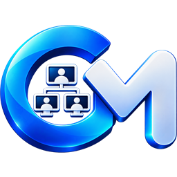

<p align="center">
  
</p>

<h1 align="center">Control Machine</h1>

<p align="center">
  Okul bilgisayar laboratuvarları için sınıf yönetim yazılımı.<br>
  Tüm öğrenci bilgisayarları tek ekranda: izleyin, kilitleyin, yayın yapın, sınav ve yarışma başlatın.
</p>

<p align="center">
  <a href="../../releases/latest"><b>⬇️ Son sürümü indir (15 gün ücretsiz deneme)</b></a>
</p>

---

## Neler yapabilirsiniz?

- **Canlı izleme** — Öğrenci ekranlarını ızgara, liste ya da sınıf planı düzeninde anlık görün.
- **Tek tıkla komut** — Kilitleyin, karartın, sessize alın, duyuru gönderin; tüm sınıfa ya da seçtiğiniz öğrencilere.
- **Ekran yayını ve uzaktan yardım** — Kendi ekranınızı yansıtın, bir öğrencinin ekranını büyütüp fare ve klavyeyle yardım edin.
- **Dosya gönder, ödev topla** — Dosya ya da klasör gönderin, ödevleri tek tıkla geri toplayın.
- **Sınav** — Soru havuzundan sınav hazırlayın; sonuçlar PDF olarak ve e-Okul için hazır tablo olarak kaydedilir.
- **Yarışmalar ve ünite testleri** — Bilgi, zekâ, klavye ve fare yarışmaları; 5. ve 6. sınıflar için hazır, görselli ünite testleri; canlı skor tablosu.
- **Güvenli internet** — İstenmeyen siteleri ve programları engelleyin, uygunsuz kelimelerden haberdar olun.
- **Ders programı ve zil** — Teneffüste ekranlar kendiliğinden kilitlenir, gün sonunda bilgisayarlar kapanır.
- **Telefondan yönetim** — Karekodu okutun, sınıfı cebinizden yönetin.
- **Windows ve Pardus** — Windows öğrenci bilgisayarları ve Pardus akıllı tahtalar desteklenir.

## Sistem gereksinimleri

| | |
|---|---|
| **Öğretmen bilgisayarı** | Windows 10 / 11, 64 bit |
| **Öğrenci bilgisayarları** | Windows 10 / 11 ya da Pardus |
| **Ağ** | Öğretmen ve öğrenci bilgisayarları aynı okul ağında |
| **İnternet** | Yalnızca deneme sürümünün ilk etkinleştirmesi için |

## Kurulum

### 1. Öğretmen bilgisayarı
1. [Son sürüm](../../releases/latest) sayfasından **ControlMachine-Deneme-Kurulum-x.y.z.exe** dosyasını indirin.
2. Dosyaya çift tıklayın, lisans sözleşmesini kabul edip kurulumu tamamlayın.
3. İlk açılışta e-posta adresinizi girip **Etkinleştir** deyin. 15 günlük deneme başlar.

> Kurulum dosyası henüz kod imzası taşımadığı için Windows **"Bilinmeyen yayıncı"** uyarısı gösterebilir:
> **Ek bilgi › Yine de çalıştır** ile devam edin.

### 2. Öğrenci bilgisayarları
1. Öğretmen konsolunda **Güncelle › Kurulum paketi hazırla**'yı seçin (Windows ya da Pardus).
2. Oluşan **tek kurulum dosyasını** USB bellekle ya da ağ üzerinden öğrenci bilgisayarına taşıyın.
3. Öğrenci bilgisayarında çalıştırın ve yönetici iznini onaylayın. Bilgisayar birkaç saniye içinde öğretmen ekranında belirir.

## Deneme sürümü

- 15 gün boyunca **tüm özellikler** açıktır.
- Süre dolunca program kilitlenir; devam etmek için lisans anahtarı gerekir.
- Bilgisayarın saatini değiştirmek deneme süresini uzatmaz.

## Gizlilik

Öğrenci verileri (adlar, sınav sonuçları, ekran görüntüleri) **okulunuzun ağından dışarı çıkmaz**; ekran görüntüleri kaydedilmez,
öğrencinin tuş vuruşları asla kaydedilmez. Deneme etkinleştirmesinde yalnızca e-posta adresi ve bilgisayarın donanım kimliği lisans
sunucusuna iletilir. Ayrıntılar: [LİSANS](LISANS.md).

## Dosyayı doğrulama

Her sürümün notlarında kurulum dosyasının **SHA-256** özeti yazar. PowerShell ile kontrol edebilirsiniz:

```powershell
Get-FileHash .\ControlMachine-Deneme-Kurulum-0.1.28.exe -Algorithm SHA256
```

## Tam sürüm ve iletişim

- E-posta: **caglargulcek@gmail.com**
- Instagram: **@aydinrobotik**

---

<sub>Control Machine kapalı kaynaklı bir yazılımdır; bu sayfa yalnızca kurulum dosyalarını ve açıklamaları içerir. © Çağlar Gülcek</sub>
